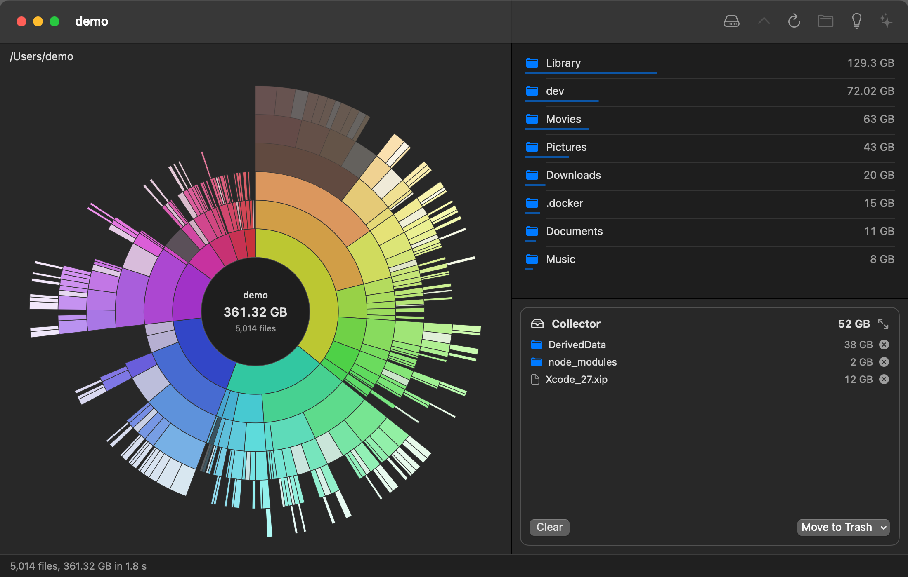

# DirSizes

A fast disk usage scanner for macOS, with a sunburst chart to find what is taking up space
and a collector to clean it up.



<sub>The screenshot shows made-up data (`make screenshot`), not a real disk.</sub>

## Features

- **Fast scanning.** Directories are read with `getattrlistbulk(2)` (names, types and sizes
  for many entries per system call) by a pool of worker threads, instead of `readdir` plus
  one `lstat` per file.
- **Quick rescans.** Each scan is saved, and the next scan of the same folder or disk only
  reads the folders that changed since, using the history macOS keeps of file changes (FSEvents).
  Scanning a subfolder of a saved scan (say `~/dev` after the whole disk) starts from that scan
  too. Rescanning 4 million files takes seconds instead of a minute. External and network drives
  get a full scan by default, since other computers may have changed them without macOS noticing.
  Hold ⌥ to switch: Update becomes Full Scan (and the other way round on external drives). Saved scans live in `~/Library/Caches/de.rnd7.dirsizes` (the five most
  recent; a whole disk takes a few hundred MB).
- **Live chart.** The top levels fill in while a scan runs, so the big folders show up long
  before the scan is done.
- **Sunburst chart.** Each ring is one level deeper. Click a folder to zoom in, click the
  center to go back up. Hover to see sizes.
- **Whole disks.** Pick a disk on the start screen and the chart also shows free space and
  space the scan couldn't account for (snapshots, purgeable data, folders without access).
- **Collector.** Drag files and folders from the chart, the list or Finder into the
  collector, then move them to the Trash or delete them in one go, with progress in bytes.
  Expand it to review everything as a chart and a tree, and keep single items out of a
  collected folder before deleting.
- **Fast permanent delete.** Uses the scan to delete many files in parallel, several times
  faster than `rm -rf` on folders with tens of thousands of files.
- **Leftovers of uninstalled apps.** The Cleanup view (💡 in the toolbar) lists caches,
  settings, containers and launch agents in `~/Library` and `/Library` that belong to apps no
  longer on your Mac, grouped by app. Entries that may still belong to something installed
  are marked "Check". Collect what you want gone and delete it from the collector.
- **Live updates.** Items deleted by other apps after the scan turn gray, so you can see
  what is already gone without scanning again.
- **MCP server.** An AI assistant can scan, explore the results and put items in the
  collector for you to review. It can't delete anything.
- **Command-line scanner.** `dirsizes scan` prints the largest entries. `dirsizes bench`
  compares the scanner with `FileManager`, `fts` and `du`. `dirsizes leftovers` lists what
  uninstalled apps left behind.

## Install

```sh
brew tap philipparndt/dirsizes
brew trust philipparndt/dirsizes
brew install --cask dirsizes
```

This installs `DirSizes.app` and links the `dirsizes` command. You can also download the
disk image from [Releases](https://github.com/philipparndt/dirsizes/releases). Builds are
signed with a Developer ID and notarized.

Requires macOS 15 or newer, on Apple silicon or Intel.

### Full Disk Access

macOS protects some folders (Desktop, Documents, Music, Photos, Mail, other apps' data).
Without Full Disk Access, it asks about each one separately during a scan, and the folders it
can't read show up as hidden space. DirSizes therefore asks for Full Disk Access at launch:
**Open System Settings** goes straight to **Privacy & Security › Full Disk Access**, and the
scan starts as soon as you turn DirSizes on. **Not Now** scans without it.

## MCP server

DirSizes includes an MCP server so an AI assistant such as Claude can answer "what is taking up
space?" and suggest a cleanup. It can scan folders and disks, list and search the results and
add items to the collector. Deleting stays with you: the collected items show up in the app,
where you decide whether to move them to the Trash.

Click the ✨ **Use with Claude** button in the toolbar. It shows the command that adds DirSizes
to Claude Code, with a Copy button. With the Homebrew cask that is:

```sh
claude mcp add --scope user dirsizes -- dirsizes mcp
dirsizes leftovers [--all]
```

For other clients, configure a stdio server that runs `dirsizes mcp`:

```json
{
  "mcpServers": {
    "dirsizes": { "command": "/Applications/DirSizes.app/Contents/Resources/bin/dirsizes", "args": ["mcp"] }
  }
}
```

`dirsizes mcp` forwards to the running app and starts it if needed. The app listens on a
random loopback port with a token that changes every launch, written to
`~/Library/Application Support/de.rnd7.dirsizes/mcp.json` (readable by you only).

| Tool | What it does |
| --- | --- |
| `status` | What was scanned, totals, scan progress, collector summary |
| `list_disks` | Mounted disks with capacity and free space |
| `scan` | Scan a folder or disk and wait for the result |
| `list` | Contents of a folder, largest first |
| `largest` | Largest files or folders anywhere below a folder |
| `search` | Find by name or glob, e.g. every `node_modules` with its total |
| `leftovers` | Data left behind by uninstalled apps, grouped by app, with a confidence |
| `collector`, `collect`, `uncollect`, `clear_collector` | Read and change the collector (never deletes) |

## Command line

```
dirsizes scan  <path> [--threads N] [--top N] [--cross-devices] [--incremental]
dirsizes bench <path> [--runs N] [--skip fm,fts,du]
dirsizes mcp
```

By default `scan` stays on the device it starts on. Add `--cross-devices` to follow mounts.
`--incremental` starts from the saved scan (shared with the app) and saves the result.

## Building

You need Xcode (the build uses Xcode's Swift toolchain through `xcrun`).

```sh
make run               # build the app and open the start screen
make run DIR=~/dev     # build the app and scan a folder
make demo              # launch with made-up data
make install           # copy DirSizes.app to /Applications
make scan DIR=~/dev    # command-line scan
make bench DIR=~/dev   # compare against FileManager, fts and du
```

With a Developer ID certificate in the keychain, `make app` signs with it, so local builds
count as the same app as the releases and keep their Full Disk Access across rebuilds.
Otherwise they are signed ad-hoc and macOS may ask again after each build
(`LOCAL_IDENTITY=-` forces ad-hoc).

## Releasing

```sh
make sign-check                       # Developer ID certificate and notarytool profile
make release-publish VERSION=0.2.0    # needs docs/release-notes-0.2.0.md
```

`release-publish` bumps `VERSION`, tags the commit, builds a universal app, signs and
notarizes it, packages and notarizes a disk image, uploads it to a GitHub release and
updates the cask in [philipparndt/homebrew-dirsizes](https://github.com/philipparndt/homebrew-dirsizes).
If only the tap step failed, `make tap VERSION=0.2.0` redoes it.
